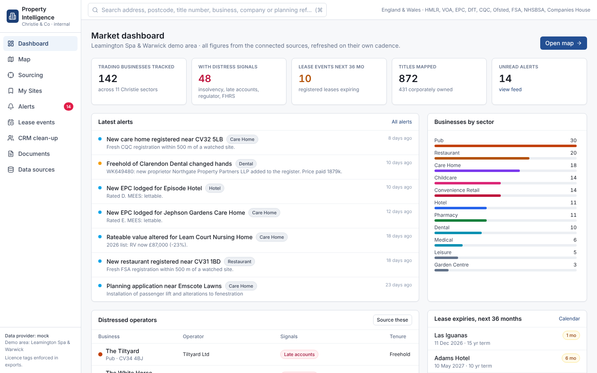
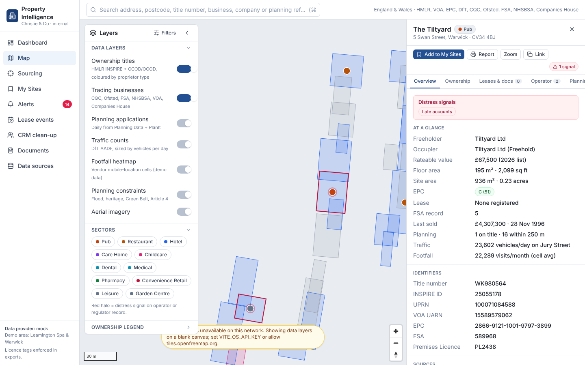
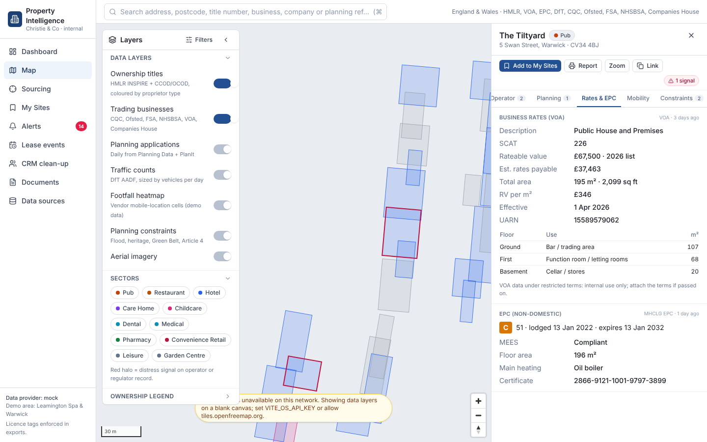
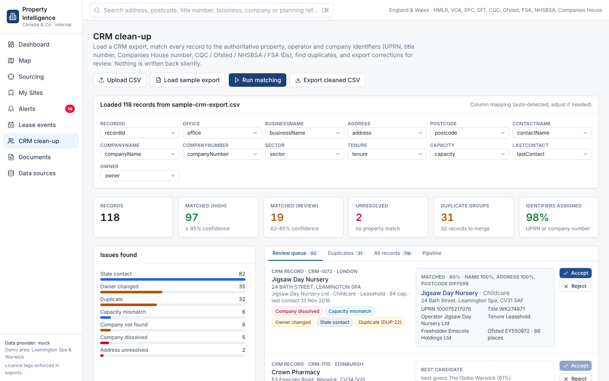
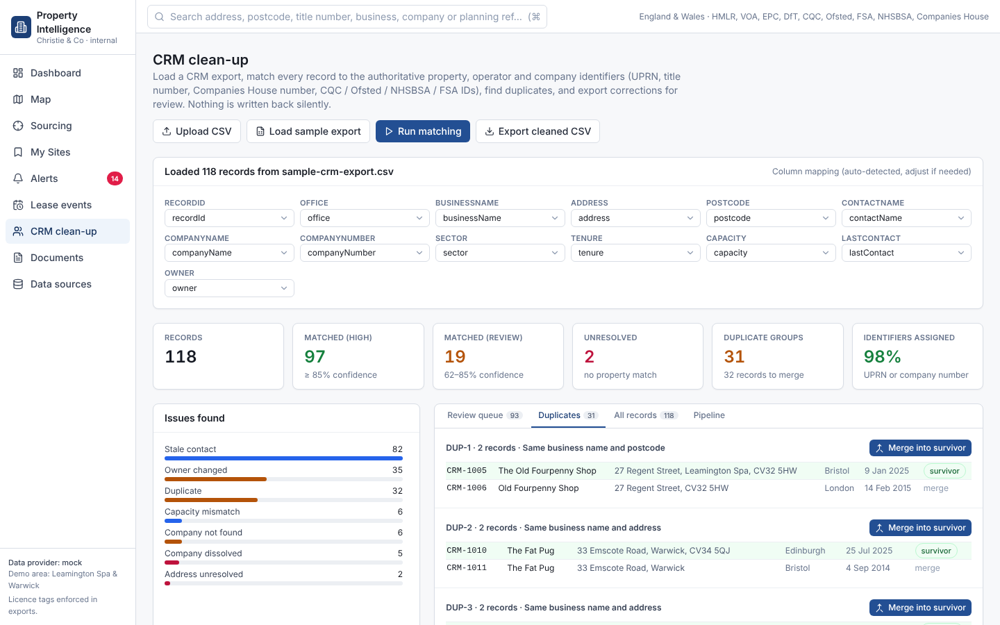
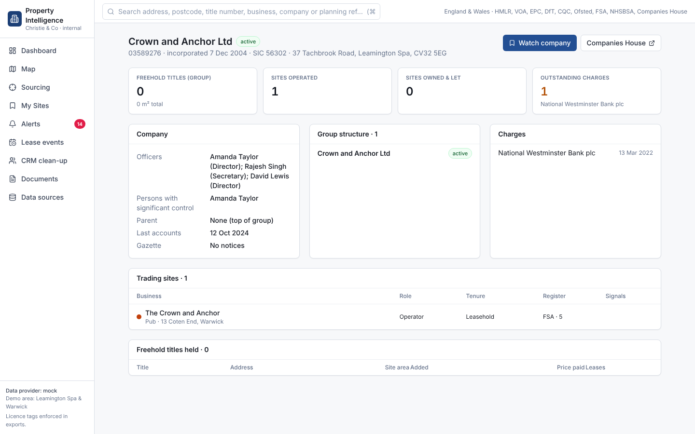
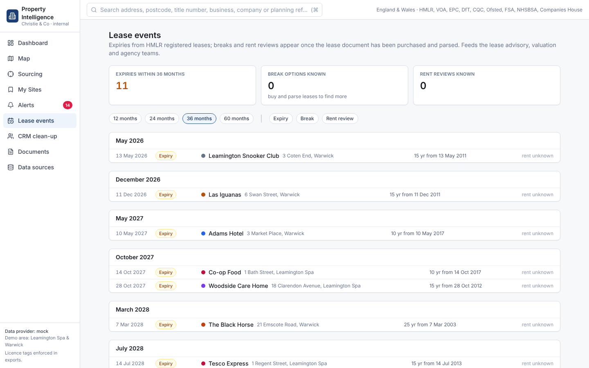
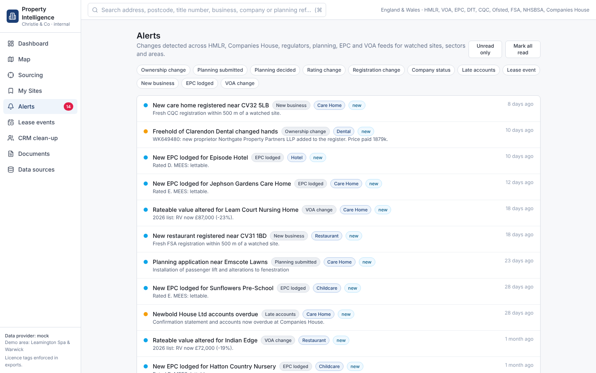
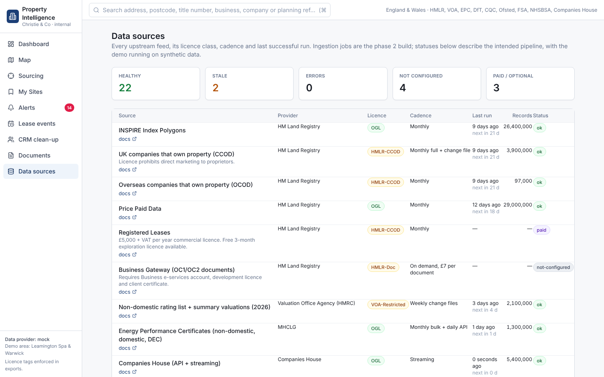

# Screenshots

Captured headlessly from the mock dataset with `npm run e2e` (basemap tiles were blocked on the capture machine, so the map shows the blank-canvas fallback).

| | |
|---|---|
|  |  |
|  |  |
|  |  |
|  |  |
|  |  |
|  |  |

Full printable site report: [report.png](report.png)
